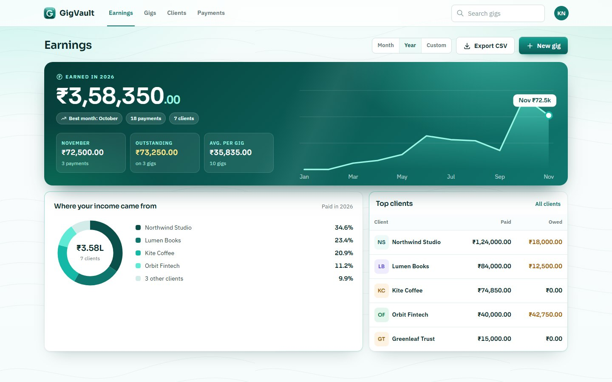
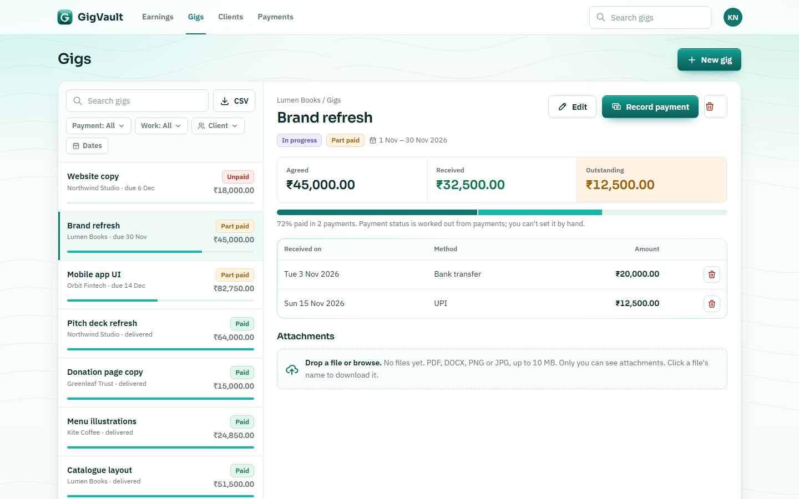

# GigVault

[](https://github.com/Pavithiran21/GigVault/actions/workflows/ci.yml)

An earnings tracker for freelancers. You record your clients, the gigs you agree with them and every payment as it arrives, partial ones included. GigVault always shows who still owes you what, and how much you earned this month, this year or in any date range.

**Python 3.15 · FastAPI · MongoDB (Decimal128, transactions) · React 19 · TanStack Query · Tailwind CSS 4 · Playwright**



**What's hard here**

- **Money is exact, end to end.** Amounts are Python `Decimal` in the code and BSON `Decimal128` in MongoDB, and every dashboard total is summed by MongoDB itself, so ten payments of 0.10 make exactly 1.00 ([money.py](backend/app/core/money.py), [dashboard_service.py](backend/app/services/dashboard_service.py)).
- **A gig can never be overpaid, even when payments arrive at the same moment.** A payment and the gig's `paidTotal` are written in one transaction, and the overpayment check is part of the update filter ([payment_service.py](backend/app/services/payment_service.py)).
- **Payment status is worked out, never typed in.** "Unpaid / part paid / paid" comes from the payments, written once in Python and once as a MongoDB filter ([payment_status.py](backend/app/core/payment_status.py)).



## Signature feature: an earnings dashboard that is right to the cent

Freelance income is many small, irregular, partial payments, so float rounding errors would show up quickly. GigVault never uses floating point for money:

- **Exact decimals end to end.** Amounts are Python `Decimal` in the code and BSON **Decimal128** in MongoDB. A codec in `backend/app/core/database.py` converts between the two, so repositories and services only ever see `Decimal`. Every dashboard total (period earnings, the month-by-month trend, earnings per client, outstanding balance) is summed by MongoDB's aggregation `$sum` on Decimal128, and rounded half-up to 2 places only for display (`backend/app/core/money.py`, `backend/app/services/dashboard_service.py`).
- **Payment status is derived, never typed in.** A gig's `paidTotal` changes only with its payments. "Unpaid / partly paid / paid" is computed from `paidTotal` versus `agreedAmount`. The same rule is written once in Python and once as a MongoDB filter, side by side in `backend/app/core/payment_status.py`.
- **A gig can never be overpaid, even under races.** A payment is inserted and added to the gig's `paidTotal` in one **MongoDB transaction**. The overpayment check is part of the update filter (`paidTotal + amount <= agreedAmount`), so it is atomic. If two payments for the same gig race, MongoDB aborts one with a write conflict, and the retry sees the first payment and refuses if together they are too much (`backend/app/services/payment_service.py`).
- **"This month" is the user's month.** Periods are worked out in the user's own time zone.

## Features

- Register, log in, profile with currency and time zone, password reset by email, delete my account (removes every record and file)
- Clients (name, contact, notes), gigs per client with agreed amount, dates and work status (pending, in progress, delivered)
- Payments against a gig, partial payments included, with the outstanding balance always shown
- Dashboard for this month, this year or a custom range: earned, outstanding, top clients, income share by client, monthly trend
- Filters by client, status and dates; paginated lists; CSV export
- Attachments (PDF, DOCX, PNG, JPG, up to 10 MB) stored in MongoDB with the gig. The real type is checked from the file's first bytes, and files are downloaded only through the owner's own endpoint.

## Roles

One role, **User**. Every query is scoped to the logged-in user; another user's client, gig, payment or file answers 404.

## Tech stack

| Layer | Choice |
|-------|--------|
| Backend | Python 3.15, FastAPI 0.162, Uvicorn, PyMongo 4.19 (async API, MongoDB Atlas), Pydantic Settings, PyJWT, bcrypt, `limits` (rate limiting), aiosmtplib |
| Frontend | React 19, Vite 8, React Router 8, TanStack Query 5, React Hook Form + Zod, Tailwind CSS 4, Tabler icons |
| Email | Any SMTP server: Ethereal for development, Brevo for real mail |

## Project structure

```
backend/
  app/
    main.py          FastAPI app, middleware, error handlers
    core/            config, database (Decimal128 codec, transactions), money, dates,
                     payment_status, file_types, auth, rate_limit, mailer, errors
    routers/         auth, profile, clients, gigs, payments, attachments, dashboard, exports
    services/        business rules (one module per area)
    repositories/    all MongoDB queries
    schemas/         Pydantic request and response models
  scripts/           make_env, seed_dev, seed_demo, seed_test, demo_inbox, drop_database
e2e/                 Playwright API and browser tests
frontend/src/        api/ auth/ features/ components/ layout/ ...
```

## Run locally

**You need** Python 3.15, Node 26 and a MongoDB Atlas free (M0) cluster.

Create `backend/.env`:

| Variable | What it is |
|----------|------------|
| `APP_ENV` | `development`, `test` or `production` |
| `PORT` | API port (4000) |
| `LOG_LEVEL` | Log level (`info`) |
| `MONGODB_URI` | Atlas connection string; its path names the database (`…/gigvault`) |
| `JWT_SECRET` | Signs access tokens (at least 32 characters) |
| `FRONTEND_URL` | `http://localhost:5173`, used in email links and CORS |
| `SMTP_HOST`, `SMTP_PORT`, `SMTP_USER`, `SMTP_PASS`, `SMTP_FROM` | Outgoing mail |
| `RATE_LIMITS_ENABLED` | `true` (log-in and reset limits) |
| `DEMO_MODE` | `true` shows the demo log-in |
| `DEMO_PASSWORD` | Password given to the seeded dev and demo accounts |
| `DEMO_SMTP_HOST`, `DEMO_SMTP_PORT`, `DEMO_SMTP_USER`, `DEMO_SMTP_PASS` | Inbox for mail to `.test` addresses, so demo mail never goes to a real server |
| `STATIC_DIR` | A folder with the built frontend. When set, the API also serves the app, so one service is the whole site (the Docker image sets it) |

Then:

```powershell
cd backend
py -3.15 -m venv .venv
.\.venv\Scripts\python.exe -m pip install -r requirements.txt
.\.venv\Scripts\python.exe -m scripts.seed_dev          # dev and demo accounts with a year of data
.\.venv\Scripts\python.exe -m uvicorn app.main:app --host 127.0.0.1 --port 4000
# API docs: http://127.0.0.1:4000/api/docs

cd ..\frontend
npm ci
npm run dev                                             # app on http://localhost:5173 (Vite proxies /api)
```

`python -m scripts.demo_inbox` creates a fresh Ethereal inbox for the `.test` addresses.

### Or with Docker

```powershell
docker compose up --build
docker compose exec app python -m scripts.seed_demo
# then open http://localhost:4000 and choose "Log in as User"
```

## Demo accounts

With `DEMO_MODE=true`, the Log in page offers **Log in as User**. The password is the one you set in `DEMO_PASSWORD`.

| Role | Email | What to try |
|------|-------|-------------|
| User | `user@demo.gigvault.test` | Kavya's year: 7 clients, 11 gigs. Open a partly paid gig, add a payment and watch the balance and dashboard change, switch the dashboard to a custom range, export CSV, attach a contract. Blocked: a gig of `other@demo.gigvault.test` opened by its id gives "not found". |

Demo accounts cannot change their email or password or delete themselves.

## Testing

**Playwright only**, in [`e2e/`](e2e): API tests with Playwright's `request` client and browser tests, against a real MongoDB (`gigvault_test`) and a real Ethereal inbox. CI runs them on every push.

- **61 tests**: 49 API and 12 browser.
- **Exact money:** ten payments of 0.10 add up to 1.00, 0.10 + 0.20 is exactly 0.30, a JSON fraction, three decimals, zero and words are refused as amounts, and the dashboard totals match hand-worked figures to the cent (earned, average per gig, best month, share per client, empty months in the trend).
- **Never overpaid:** eight payments of 30.00 sent at once against 100.00 save exactly three and refuse five; ten payments of 10.00 sent at once all save and end exactly paid. The agreed amount can drop to what was received, not below it.
- **Status and time zones:** unpaid, part paid and paid follow the payments (a "paid" in the request is ignored), and a payment dated "tomorrow" in the user's own time zone is refused while the same date is accepted in a zone ahead.
- **Files:** the real type comes from the first bytes (a text file called `.pdf` and a ZIP that is not a Word file are refused), 10 MB is kept and over it is 413, and a file is downloaded only by its owner.
- **Access:** another user's client, gig, payment and file answer 404 on every route; a client with gigs can't be deleted (409); deleting a gig removes its payments and files.
- **CSV:** exact amounts, filters shared with the list, and a title starting with `=`, `+`, `-` or `@` is saved as text so a spreadsheet never runs it.
- **Accounts:** the refresh token works once, a password change signs out other sessions, a reset link from the real inbox works once and only the newest works, and demo accounts can't change their password or be deleted.
- **In the browser:** the two-step log-in and the redirect back to the page asked for, sign-up, the demo panel, recording partial payments with the balance and toast following, the overpayment message under the amount field, attaching and downloading a file, and the CSV export.

```powershell
cd e2e
npm ci
npx playwright install chromium
npm test        # writes backend/.env.test, seeds gigvault_test, starts the API and app on their own ports, runs everything
```

The tests need a MongoDB that can run transactions (a replica set; Atlas is one). Dates in the money tests are fixed in the past, so the results are the same on any day.

## Deploy

One free [Render](https://render.com) web service from the `Dockerfile` (see [`render.yaml`](render.yaml)): FastAPI serves the built frontend, so the app, the API and the refresh cookie share one origin, with no CORS or cross-site cookies.

- **Database:** MongoDB Atlas free (M0) with a `gigvault_demo` database; allow Render's outbound IPs (or 0.0.0.0/0) under Network Access. Use Atlas, not a standalone MongoDB: payments need transactions.
- **Settings:** `APP_ENV=production`, `FORWARDED_ALLOW_IPS=*`, `DEMO_MODE=true`, `DEMO_PASSWORD`, `FRONTEND_URL` = the service URL, and SMTP for real mail (Brevo) plus `DEMO_SMTP_*` (Ethereal) for the demo accounts' mail.
- **Demo data:** free Render services have no Shell, so run `python -m scripts.seed_demo` once from your own machine, with `ENV_FILE` pointing at an env file whose `MONGODB_URI` ends in `/gigvault_demo`.

Free services sleep after 15 minutes without traffic, so the first visit after that takes about a minute. Free Render also blocks outbound SMTP (ports 25, 465 and 587), so the live demo sends no email; everything else works.

## Demo videos

- `GigVault-full-workflow.webm`: sign-up, clients and gigs, four part payments exact to the cent, the period totals, five payments sent at once on one gig (only the ones that fit are saved), an attachment, CSV export, and password reset
- `GigVault-user-demo.webm`: the User role walkthrough

<!-- To embed: edit this README on GitHub and drag the .webm files from the workspace videos/ folder here. -->

## License

Copyright (c) 2026 R.Pavithiran. All rights reserved. The source is public so you can read it and see how it is built. Please ask before copying, reusing or redistributing it.
